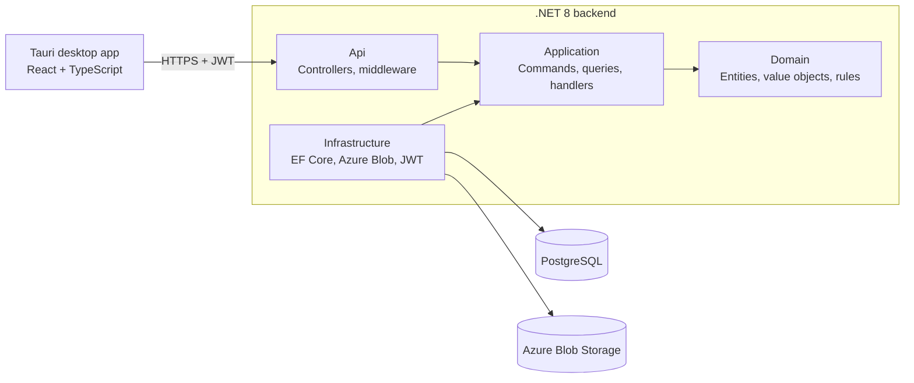

<div align="center">

# 🎧 Breezy

**A collaboration and version-control platform for music producers.**

Keep every version of your DAW projects, organize your samples into sound packs,
and collect ideas from other producers in collaboration sessions, all in one desktop app.


</div>

---

## 💡 The problem

Music producers work with large binary files that tools like Git were never designed for, and they collaborate in ways that rarely leave a trace:

- **Project chaos.** Folders full of `beat_final_v3_FINAL_real.flp`, with no way to tell what changed between versions or go back to the one that sounded right.
- **Scattered samples.** Loops and one-shots live across downloads, chats and cloud drives, without consistent tags for BPM, key or category.
- **Invisible collaboration.** Stems and loops are sent over WhatsApp, Instagram DMs or email. When a track is released, there is often no record of who contributed what, which leads to credit disputes.

**Breezy** brings these three workflows into one place.

## ✨ Features

### 📁 Project versioning
- Upload a DAW project (FL Studio, Ableton, etc.) and Breezy keeps its full **version history**.
- Every version is fingerprinted with a **SHA-256 hash**, so uploading an unchanged file is detected and rejected.
- Add a **changelog** to each version to remember what changed.

### 🎛️ Sound packs
- Organize samples into packs with genre, mood and category.
- **Audio duration is detected automatically** from the file; no manual input.
- 18 sample categories (Kick, Snare, 808, Loop, Vocal…). BPM and key are optional, because a kick has neither.
- Export a whole pack as a **ZIP archive**.

### 🤝 Collaboration sessions
- Create a session and share a **6-character join code**.
- Two session types:
  - **Curated**: only the owner sees submissions (beat battles, sample calls).
  - **Collaborative**: every participant sees everything (jam sessions).
- Participants submit audio samples directly into the session.
- Participants can **leave**, owners can **remove** participants, and anyone can **archive** a session from their own list.
- **Nothing is ever deleted.** Participation history, including who left and who was removed by the owner, is kept as a **verifiable record of collaboration** that can settle credit disputes later.

### 🔐 Security
- JWT authentication with protected routes.
- Every resource is **ownership-checked on the server**. The user identity is always taken from the validated token, never from client input (see [Engineering highlights](#-engineering-highlights)).

## 📸 Screenshots

| Sound pack | Project versions |
|---|---|
|  |  |

| Sessions | Login |
|---|---|
|  |  |

## 🛠️ Tech stack

| Layer | Technologies |
|---|---|
| **Desktop app** | Tauri 2, React, TypeScript, Vite, React Router |
| **Backend** | .NET 8, ASP.NET Core Web API, MediatR (CQRS), FluentValidation, Serilog |
| **Data** | PostgreSQL, Entity Framework Core 8 |
| **File storage** | Azure Blob Storage (Azurite for local development) |
| **Auth** | JWT Bearer tokens, BCrypt password hashing |
| **Testing** | xUnit, unit and integration tests |

## 🏗️ Architecture

The backend follows **Clean Architecture**: business rules live in the Domain layer and know nothing about the database, HTTP or Azure.



- **Domain**: entities such as `DawProject`, `SoundPack` and `CollaborationSession` own their rules. For example, a session itself decides who may submit, who may see submissions and whether a removed participant may rejoin.
- **Application**: each use case is a MediatR command or query with its own handler (CQRS).
- **Infrastructure**: EF Core repositories, Azure Blob Storage and JWT generation, behind interfaces defined in Application.
- **Api**: thin controllers that translate HTTP into commands.

## 🔍 Engineering highlights

Some of the problems solved while building Breezy:

- **IDOR vulnerability audit and fix.** Endpoints originally accepted `userId` from the request, which let any logged-in user act on another user's data. All controllers now derive the user from the JWT `sub` claim through a shared `ApiControllerBase`, and every handler that touches a resource checks ownership.
- **Request DTOs separated from commands.** Commands that contain server-controlled fields (such as the owner ID) are no longer bound directly from the HTTP body, so the client cannot set them.
- **EF Core change-tracking pitfalls.** Adding children to tracked aggregates was producing `UPDATE` instead of `INSERT` and concurrency exceptions. Fixed with explicit `Add…Async` repository methods and correct `Include` usage.
- **Domain bugs caught by reading the model.** For example, version numbering created duplicate `v1` entries, and a participant check was inverted so that real participants were rejected. Both were fixed and covered by unit tests.
- **History-preserving domain design.** Leaving, removal and archiving are modeled as state on the participant record, not deletions, so the collaboration record stays intact.

## 📂 Project structure

```
Breezy/
├── Breezy.Api/              # Controllers, middleware, Program.cs
├── Breezy.Application/      # Commands, queries, handlers, DTOs, interfaces
├── Breezy.Domain/           # Entities, value objects, domain rules
├── Breezy.Infrastructure/   # EF Core, repositories, Azure Blob, migrations
├── Breezy.Tests/            # Unit and integration tests
└── breezy-frontend/         # Tauri + React desktop app
    ├── src/
    │   ├── pages/           # Dashboard, Projects, Sound Packs, Sessions…
    │   ├── components/      # Layout, sidebar, page header
    │   ├── context/         # Authentication state
    │   └── utils/           # Hashing, audio duration, JWT decoding
    └── src-tauri/           # Native desktop shell
```

## 🗺️ Roadmap

- [ ] **Automatic versioning**: detect `Ctrl+S` in the DAW through a file watcher and offer to save a new version with a changelog
- [ ] **Background export queue**: ZIP exports processed by a background worker with parallel downloads
- [ ] **Notifications**: real-time updates with SignalR and native desktop notifications
- [ ] **Email submissions**: a unique email address per session, so anyone can send samples to a public call
- [ ] **Storage management**: favorite submissions, move them into a pack, automatic cleanup of closed sessions
- [ ] **Audio playback and waveforms** directly in the app
- [ ] **Refresh tokens** and secure token storage in the OS keychain
- [ ] **Cloud deployment** on Azure with CI/CD through GitHub Actions

## ⚖️ License and copyright

**Copyright © 2026 Stefan Galit. All rights reserved.**

Breezy, including its source code, design, documentation and concept, is the intellectual property of Stefan Galit.

This repository is public **for portfolio and evaluation purposes only**. You are welcome to read the code and review the project. Without prior written permission from the author, you may not:

- copy, reproduce or redistribute the code, in whole or in part;
- use it, or derivatives of it, in other projects, commercial or non-commercial;
- publish, sell or deploy the application or any modified version of it.

For licensing, collaboration or any other use, please contact the author.

## 👤 Author

**Stefan Galit**: .NET developer and music producer, Information Technology student at the Technical University of Moldova.

- GitHub: [@stefangalit21](https://github.com/stefangalit21)
- LinkedIn: *add your link*
- Email: *add your email*

Breezy started as my bachelor's thesis and grew out of my own experience as a producer.
